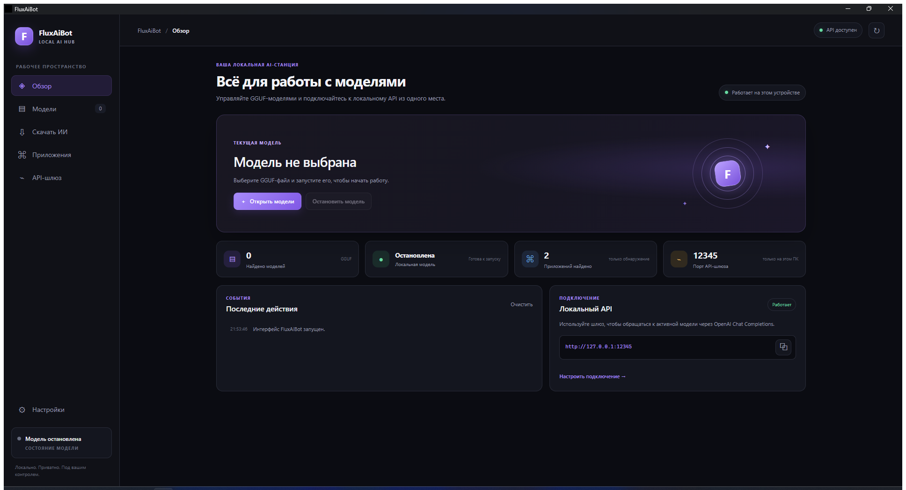

# FluxAiBot — Local AI Hub

FluxAiBot is a Windows desktop application for running local GGUF models through a bundled `llama.cpp` server and accessing the active model through a loopback-only HTTP gateway.



[Download the latest release](https://github.com/Heepean/fluxaibot/releases/latest) — portable EXE, installer, and SHA-256 checksums.

## Getting started

1. Start FluxAiBot.
2. In **Models**, choose a folder containing a `.gguf` model and scan it.
3. Start a model from the results.
4. In **API Gateway**, copy the gateway token when needed. The token is generated for the current application run and is not shown until requested.

See the [Russian user guide](docs/USER_GUIDE_RU.md) and [v1.0.0 release notes](docs/RELEASE_NOTES_v1.0.0.md) for installation, model selection, GPU behavior, API setup, and limitations.

On Windows, run `Publish-to-GitHub.bat` to push the prepared source and release. If needed, it opens the official browser sign-in before publishing to [GitHub Releases](https://github.com/Heepean/fluxaibot/releases).

The portable application is distributed as a single EXE; the installer is a separate NSIS setup EXE. The verified `llama-server` runtime is embedded in the application and extracted to `%LOCALAPPDATA%\\FluxAiBot\\runtime` on first use. The application does not include a GGUF model. Model files remain in the folder you choose. The last successfully scanned model folder is saved in the local application database and restored on the next launch; use **Scan** to refresh its model list. The API gateway listens on `127.0.0.1:12345`; the bundled model runtime listens on `127.0.0.1:12346`.

Scanning only reads directory entries and model metadata; it does not hash multi-gigabyte model files. Before launch, the selected model's size and modification timestamp are checked against the scan. Files named `mmproj-*.gguf` are multimodal projector sidecars, not standalone language models. Select the main model GGUF to start inference; projector files are detected but cannot be launched separately.

The runtime prefers an available CUDA device, then Vulkan, and finally CPU. GPU runs request automatic layer offload and llama.cpp memory fitting; if a GPU runtime fails readiness, FluxAiBot reports the reason and tries the next backend. The active backend and device are shown in status. Vulkan inference has been verified on an AMD Radeon RX 7700 XT; CUDA is built for NVIDIA devices, but CUDA inference requires validation on NVIDIA hardware.

## Download models from Hugging Face

The **Download AI** tab searches Hugging Face for public, non-gated text-generation repositories tagged GGUF. Search results show available GGUF files and complete shard sets, licensing metadata when supplied, file-size filters, and a memory suitability estimate based on available RAM plus the preferred GPU's available VRAM. The estimate is approximate (GGUF size × 1.5 + 1 GiB); it does not benchmark inference speed or guarantee a model will load. Check the author's model card and license before downloading.

Downloads go to the last selected model library folder, or `%LOCALAPPDATA%\FluxAiBot\models` if none has been selected. They are staged in a temporary directory, checked against Hub-reported file size and LFS SHA-256 when available, and moved into the library only after all selected files pass verification. Downloads can be cancelled; a running model must be stopped first. Authentication-gated/private models and `mmproj` projector files are not offered.

The purpose filter heuristically distinguishes coding-focused models from general chat models using repository names and Hub tags. Image and video inference are not supported by the current runtime/UI and are not offered as runnable catalog categories.

## API

The implemented model endpoints are:

- `GET /health`
- `GET /v1/models`
- `POST /v1/chat/completions`
- `GET /hub/v1/capabilities`
- `GET /hub/v1/status`

Model endpoints require an `Authorization: Bearer YOUR_TOKEN` header. Get the current token in the desktop app. Use a model ID returned by `GET /v1/models`.

```python
import openai

client = openai.OpenAI(
    base_url="http://127.0.0.1:12345/v1",
    api_key="<token copied from FluxAiBot>",
)

models = client.models.list()
model_id = models.data[0].id
response = client.chat.completions.create(
    model=model_id,
    messages=[{"role": "user", "content": "Привет!"}],
)
print(response.choices[0].message.content)
```

The gateway currently implements OpenAI Chat Completions only. It does not claim support for OpenAI Responses or Anthropic Messages. Integration detection is informational; automatic configuration of external coding tools is not currently verified.

## Runtime and data

- Target: Windows 10/11 x64.
- The bundled `llama-server.exe` is verified against the hash in `src-tauri/resources/runtime-manifest.json` before launch.
- Portable builds and the NSIS installer contain the runtime inside the main application executable; only the runtime copy extracted to `%LOCALAPPDATA%` is needed to launch it.
- Application data and SQLite storage are kept under `%LOCALAPPDATA%\FluxAiBot`.
- The gateway binds only to loopback; it is not exposed to the LAN.

Run `.\build-release.ps1` from PowerShell to create a timestamped release directory in `dist` containing `FluxAiBot-portable.exe` and `FluxAiBot-setup.exe`.

## Troubleshooting

If a model fails to reach readiness, FluxAiBot reports the runtime's health response and a bounded set of startup error messages. These diagnostics are kept in memory only and are collected only before the model is ready; prompts and generated responses are not recorded. If the error says a CLIP model cannot be used as the main model, select the language model GGUF instead of an `mmproj` projector file.

## Project layout

- `src-tauri/` — Rust/Tauri backend, runtime management, API gateway, and integration discovery.
- `ui/index.html` and `ui/app.js` — desktop interface.
- `docs/COMPATIBILITY_SPIKE.md` — integration compatibility notes and verification limits.
