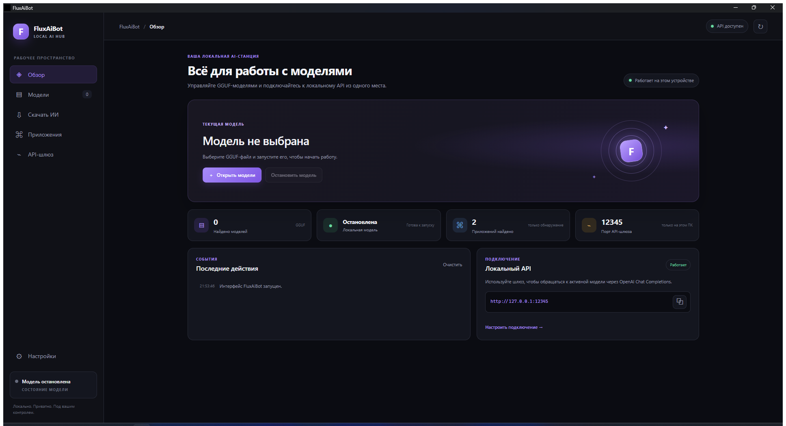

# FluxAiBot — Local AI Hub

FluxAiBot — настольное приложение для Windows 10/11 x64: запуск локальных GGUF-моделей, автоматический выбор CUDA/Vulkan/CPU и локальный OpenAI-совместимый API-шлюз.

[Руководство пользователя: установка, запуск модели, GPU, API и устранение неполадок](docs/USER_GUIDE_RU.md)

[Скачать последнюю версию](https://github.com/Heepean/fluxaibot/releases/latest) — portable EXE, установщик и SHA-256-суммы.

## Портативная версия и установщик

Портативная версия поставляется одним файлом `FluxAiBot-portable.exe`; установщик — отдельным `FluxAiBot-setup.exe` (NSIS). Runtime `llama-server` встроен в EXE, проверяется по SHA-256 из манифеста и при первом запуске атомарно извлекается в `%LOCALAPPDATA%\FluxAiBot\runtime`. GGUF-модели остаются во выбранной пользователем папке, а база и настройки — в `%LOCALAPPDATA%\FluxAiBot`.

Сканирование папок не читает содержимое файлов моделей и поэтому не вычисляет SHA-256 для многогигабайтных GGUF. Оно читает записи каталогов, размер и время изменения; перед запуском выбранной модели эти метаданные проверяются повторно. Это значительно сокращает время поиска, но не является проверкой криптографической целостности модели.

## Каталог моделей Hugging Face

Вкладка «Скачать ИИ» ищет публичные, не требующие gated-доступа текстовые GGUF-модели. Она показывает отдельные варианты и полные наборы шардов, фильтр размера и приблизительную оценку памяти на основе доступной ОЗУ и свободной VRAM предпочтительного GPU (CUDA, затем Vulkan; размер GGUF × 1,5 + 1 ГиБ). Это не измерение скорости и не гарантия запуска. Перед скачиванием проверьте лицензию и карточку автора.

Файлы загружаются в последнюю выбранную папку моделей, а если папка не выбрана — в `%LOCALAPPDATA%\FluxAiBot\models`. Загрузка поддерживает отмену, выполняется во временный каталог и завершается только после проверки размера и SHA-256, если Hub предоставляет LFS-хэш. Загрузка блокируется, пока работает модель. Успешный запуск скачанной модели зависит от ресурсов ПК и пока не подтверждён для каждого варианта.

Runtime сначала проверяет CUDA, затем Vulkan и использует CPU как запасной вариант. При запуске на GPU включается автоматическое распределение слоёв и подбор размещения по памяти; если GPU runtime не становится готовым, приложение сообщает причину и пробует следующий backend. Активный backend и устройство отображаются в статусе. Vulkan-инференс проверен на AMD Radeon RX 7700 XT; сборка CUDA предназначена для NVIDIA, но проверка инференса требует ПК с NVIDIA GPU.

Фильтр каталога различает модели для кодинга и универсальные чат-модели по тегам и названию репозитория; это эвристика, проверьте карточку автора. Анализ/генерация изображений и видео сейчас не поддерживаются текущим интерфейсом и runtime, поэтому эти категории недоступны и такие модели не рекомендуются к скачиванию из приложения.

Для сборки обоих артефактов из корня проекта запустите `.\build-release.ps1`. Требуются Rust/MSVC, WebView2 Runtime и установленный Tauri CLI 2.x.

**Цель:** Windows 10/11 x64 приложение на Rust для запуска локальных моделей и безопасного подключения Claude Code, Codex, VS Code, OpenCode, LM Studio и LM Studio Bionic там, где существует документированный способ интеграции.

## Важно
Репозиторий содержит приложение Windows и технические документы. Статус каждой интеграции ограничен подтверждёнными возможностями из таблицы ниже; не показывайте «Успешно» до end-to-end проверки. Приложение не должно обходить авторизацию/лицензии поставщиков или редактировать недокументированные внутренние файлы.

## Архитектурное решение
- Язык ядра: Rust stable.
- Desktop GUI: Tauri 2.
- Runtime: llama.cpp `llama-server` для GGUF; приоритет CUDA, затем Vulkan, затем CPU.
- Gateway: локальный HTTP API, loopback по умолчанию.
- База: SQLite; конфиги внешних программ редактируются транзакционно с backup/diff/rollback.
- Модели: GGUF в выбранных пользователем каталогах.

## Интеграции — реальный статус
| Программа | Способ | Ограничение |
|---|---|---|
| Claude Code | Anthropic Messages API, `ANTHROPIC_BASE_URL` в окружении дочернего процесса | Нужны Windows shell/WSL проверки и реальная совместимость tool use |
| Codex | Документированный LM Studio OSS workflow (`codex --oss`) | Произвольный Hub endpoint нельзя считать поддержанным без проверки версии Codex |
| VS Code | Custom Endpoint provider в Language Models editor | BYOK local не включает inline completions и некоторые Copilot функции |
| OpenCode | Custom provider | Схема и API package зависят от версии и протокола |
| LM Studio | `lms` CLI + HTTP API | Команды проверять по версии |
| Bionic | Поддерживаемая работа с локальной библиотекой моделей | Generic сторонний endpoint не подтверждён публичной документацией |

## Состав
- `START_HERE_RU.md` — что поручить ИИ-разработчику в первую очередь.
- `MASTER_SPEC.md` — полное ТЗ.
- `ARCHITECTURE.md` — архитектура компонентов.
- `ENGINE_SPECS/` — runtime, API gateway и process manager.
- `INTEGRATIONS/` — по отдельному документу для каждой программы.
- `API_SPEC.md`, `SECURITY.md`, `CONFIGURATION_AND_ROLLBACK.md`.
- `UI_SPEC.md`, `TEST_PLAN.md`, `BUILD_AND_RELEASE.md`.
- `IMPLEMENTATION_ROADMAP.md`, `AGENTS.md`.
- `SOURCES_AND_RESEARCH.md` — официальные источники.

## Документы
Остальные спецификации описывают архитектуру и ограничения интеграций; используйте таблицу выше и end-to-end проверки как источник фактического статуса реализации.
