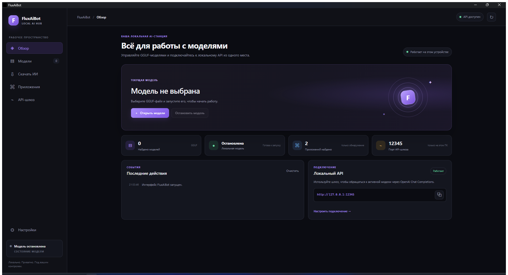

# Руководство пользователя FluxAiBot

FluxAiBot запускает локальные GGUF-модели на Windows 10/11 x64 и предоставляет локальный OpenAI-совместимый API. Модель не входит в дистрибутив: подготовьте место на диске для выбранной модели. Для интерфейса нужен WebView2 Runtime.

## Установка и первый запуск

1. Скачайте `FluxAiBot-portable.exe` для запуска без установки или `FluxAiBot-setup.exe` для установки в Windows.
2. Запустите приложение. При отсутствии драйвера GPU или подходящего устройства приложение может использовать CPU.
3. На вкладке **Модели** укажите папку с `.gguf`-файлами и нажмите **Сканировать**.
4. Выберите основную языковую модель и нажмите **Запустить**. Файл-проектор с именем `mmproj` не является самостоятельной языковой моделью.
5. Дождитесь состояния готовности. В статусе отображаются активный вычислительный backend и устройство.

Последняя выбранная папка моделей сохраняется и восстанавливается после перезапуска. Модели и настройки хранятся отдельно от EXE в `%LOCALAPPDATA%\FluxAiBot`; портативный EXE не переносит за собой пользовательскую библиотеку моделей.

Файлы релиза не подписаны Authenticode, поэтому Windows может показать предупреждение о неизвестном издателе.

## Выбор и загрузка модели

На вкладке **Скачать ИИ** можно искать публичные GGUF-модели Hugging Face без gated-доступа. Используйте фильтр размера и назначения (кодинг или универсальная модель), изучите карточку модели и лицензию автора, затем скачайте подходящий вариант.

Оценка памяти приблизительная и не гарантирует запуск или скорость. Для первого запуска выбирайте квантованную модель, размер которой оставляет запас ОЗУ/VRAM для Windows и других программ. По возможности сначала остановите ненужные тяжёлые приложения.

Модели изображений и видео сейчас не поддерживаются. Категория модели определяется эвристически по карточке и может быть неточной.

## GPU и производительность

При доступном устройстве приложение пробует backend в порядке CUDA (NVIDIA), Vulkan, затем CPU. Переход на следующий backend выполняется, если предыдущий не готов к работе. Инференс Vulkan проверен на AMD Radeon RX 7700 XT. Сборка CUDA включена, но инференс CUDA необходимо отдельно проверить на компьютере с NVIDIA GPU.

Размер модели, контекст, число параллельных задач и другие программы влияют на потребление памяти и скорость. Фильтр памяти является ориентиром, а не бенчмарком. При нехватке памяти остановите модель, освободите ресурсы или выберите меньшую/сильнее квантованную модель.

## Подключение приложений через API

Вкладка **API-шлюз** показывает состояние локального шлюза и предоставляет токен для текущего запуска. Базовый URL шлюза: `http://127.0.0.1:12345/v1`. Он привязан к localhost и не предназначен для доступа из локальной сети. Шлюз поддерживает OpenAI Chat Completions; используйте идентификатор модели, показанный самим шлюзом.

Вставляйте URL и токен только в поддерживаемые настройки внешнего приложения. Возможности интеграций зависят от версии программы; смотрите [матрицу совместимости](COMPATIBILITY_SPIKE.md). Не считайте обнаружение приложения подтверждением рабочего подключения.

## Остановка и данные

Остановите модель в приложении перед закрытием, чтобы освободить память и завершить локальный inference-процесс. Не удаляйте `%LOCALAPPDATA%\FluxAiBot`, если хотите сохранить настройки и состояние библиотеки.

## Устранение неполадок

- **Модель не запускается:** проверьте, что выбрана основная языковая GGUF-модель, а не `mmproj`; попробуйте меньшую модель и проверьте свободную ОЗУ/VRAM.
- **Нет GPU или произошёл переход на CPU:** проверьте драйвер устройства. Для CUDA нужен совместимый драйвер NVIDIA; Vulkan зависит от драйвера и поддержки Vulkan.
- **Загрузка недоступна:** вкладка предлагает публичные модели без gated-доступа. Проверяйте доступность репозитория и лицензию на Hugging Face.
- **Интеграция не подключается:** проверьте официальный способ настройки и совместимость версии внешней программы; не обходите авторизацию или ограничения поставщика.
